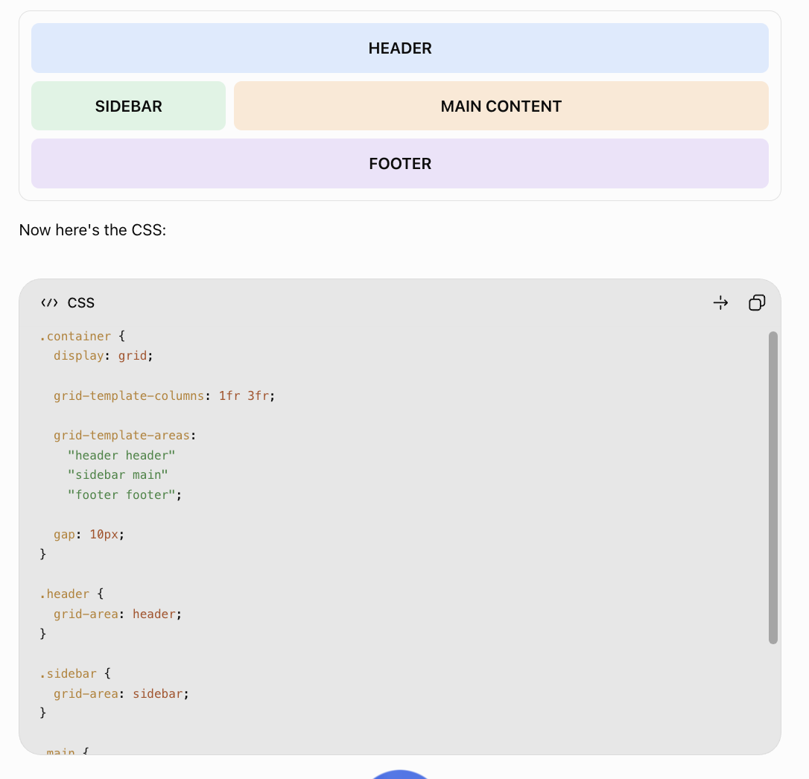

## CSS Grid properties

### 1. Parent properties (Grid container)

These properties are applied to the main container that holds the boxes.

| Property                | What it does                                         |
| ----------------------- | ---------------------------------------------------- |
| `display: grid`         | Activates CSS Grid.                                  |
| `grid-template-columns` | Defines the number and width of columns.             |
| `grid-template-rows`    | Defines the number and height of rows.               |
| `grid-template-areas`   | Creates named sections in your layout.               |
| `grid-auto-columns`     | Sets the size of automatically created columns.      |
| `grid-auto-rows`        | Sets the size of automatically created rows.         |
| `grid-auto-flow`        | Controls how items are automatically placed.         |
| `gap`                   | Adds spacing between rows and columns.               |
| `row-gap`               | Adds spacing between rows.                           |
| `column-gap`            | Adds spacing between columns.                        |
| `justify-items`         | Aligns items horizontally inside their grid cells.   |
| `align-items`           | Aligns items vertically inside their grid cells.     |
| `place-items`           | Shorthand for `align-items` and `justify-items`.     |
| `justify-content`       | Aligns the entire grid horizontally.                 |
| `align-content`         | Aligns the entire grid vertically.                   |
| `place-content`         | Shorthand for `align-content` and `justify-content`. |

### 2. Child properties (Grid items)

These properties are applied to individual boxes inside the grid.

| Property       | What it does                                                     |
| -------------- | ---------------------------------------------------------------- |
| `grid-column`  | Controls which columns an item occupies.                         |
| `grid-row`     | Controls which rows an item occupies.                            |
| `grid-area`    | Assigns an item to a named area or specifies its grid placement. |
| `justify-self` | Aligns one item horizontally inside its cell.                    |
| `align-self`   | Aligns one item vertically inside its cell.                      |
| `place-self`   | Shorthand for `align-self` and `justify-self`.                   |
| `order`        | Changes the visual order of an item.                             |

## Quick comparison: Flexbox vs Grid

| Flexbox           | CSS Grid                                |
| ----------------- | --------------------------------------- |
| `display: flex`   | `display: grid`                         |
| `flex-direction`  | `grid-auto-flow`                        |
| `flex-wrap`       | `grid-template-columns` with `auto-fit` |
| `justify-content` | `justify-content`                       |
| `align-items`     | `align-items`                           |
| `align-self`      | `align-self`                            |
| `gap`             | `gap`                                   |
| `order`           | `order`                                 |

## Grid Template Areas — Layout Example

